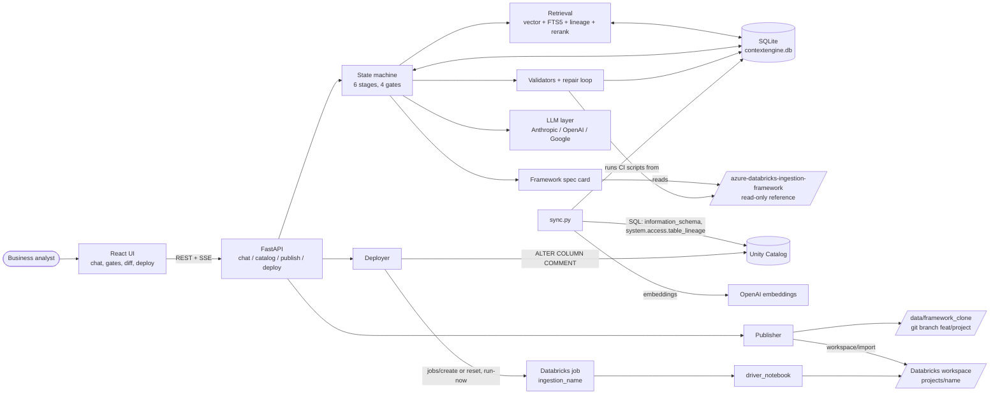
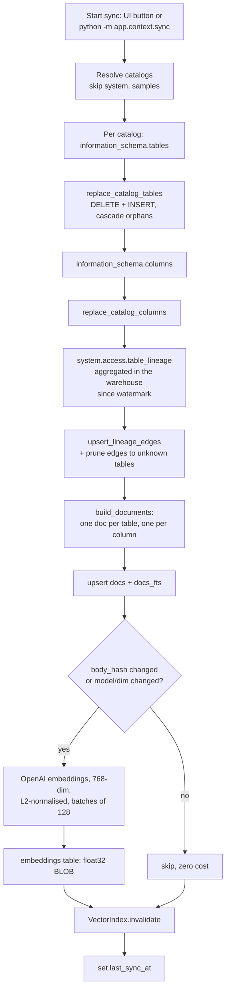
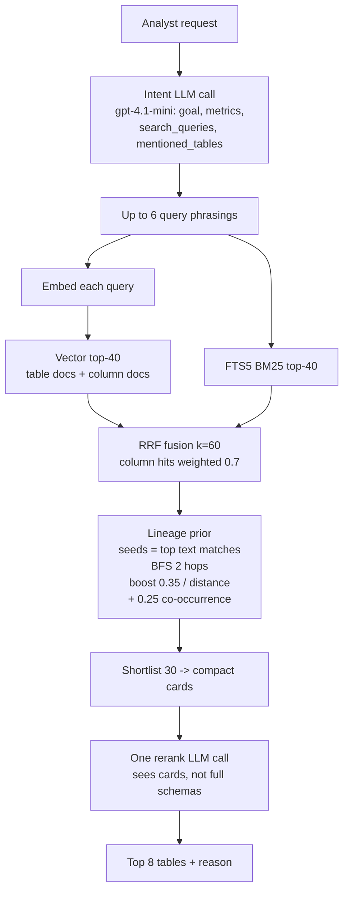
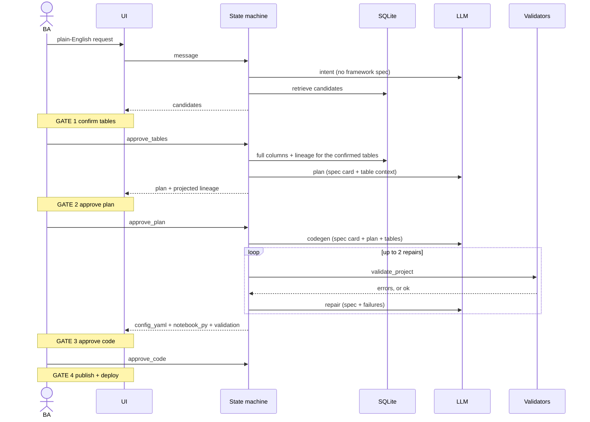
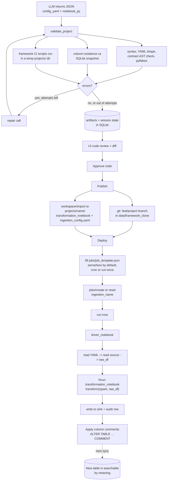

# ContextEngine architecture

How the whole project works: where the framework lives, what the LLM sees,
how the catalog is synced and searched, what is in SQLite, and how generated
code travels from a chat message to a running Databricks job.

Diagrams are Mermaid. They render in Cursor's markdown preview and on GitHub.

## Short answers

**Where is the framework stored or cached?** It is not in the database.

- **Reference copy:** read live from disk at `paths.framework_repo`
  (`../azure-databricks-ingestion-framework`). Read-only; ContextEngine never
  writes there.
- **Memory cache:** `framework_spec.py` caches the imported config module, the
  example projects and the static spec card in memory with `lru_cache`. This
  lasts until the server restarts.
- **Working clone:** `ContextEngine/data/framework_clone` is a separate git
  repo that generated projects are committed into. It is seeded from a copy of
  the framework because that folder is a subdirectory of the outer repo, not a
  repo root.
- **Databricks workspace copy:**
  `/Workspace/Shared/azure-databricks-ingestion-framework` is where jobs
  actually run it from. Publish uploads generated projects there.

**Is the whole repo sent to the LLM?** No. It sends a **spec card**, built once
from the framework:

- the hard rules, written as text
- the config schema, from `IngestionConfig.model_json_schema()`
- the conditional validator functions, copied verbatim
- two example projects, picked by closeness of source type, sink type and
  write mode

The card is about 3-4k tokens, marked cacheable, and sent only to the plan,
codegen and repair stages. The framework's `src/` code (readers, writers,
runner) is never sent. Later stages read frozen approved artifacts instead of
replaying the whole chat, so cost stays flat.

**How is the catalog synced?** `app/context/sync.py` queries the SQL warehouse
for `information_schema.tables` and `.columns`, plus
`system.access.table_lineage`. Everything lands in one SQLite file.

- **Tables and columns:** replaced per catalog on every sync, so dropped tables
  disappear.
- **Lineage:** incremental, using a `lineage_synced_through` watermark, over a
  90-day first window.
- **Embeddings:** incremental. Only documents whose content hash changed are
  re-embedded.

After a sync, search, lineage and the lineage preview run locally. The
warehouse is not touched again.

## 1. System overview

## 2. The sync flow and what lands in SQLite

One file, `data/contextengine.db`, holds everything:

| Table | Purpose |
|---|---|
| `tables_meta`, `columns_meta` | Snapshot of tables and columns: type, owner, comments, ordinal |
| `lineage_edges` | `source_id`, `target_id`, entity type and id, occurrence count, last event |
| `docs` | Text of each table doc and column doc, with a content hash |
| `docs_fts` | FTS5 index over the same text, for BM25 keyword search |
| `embeddings` | One vector (float32 BLOB) per doc, keyed to `docs` |
| `vec_docs` | Optional sqlite-vec virtual table, rebuilt from the embeddings in memory. Falls back to a numpy scan if the extension isn't available |
| `sync_state` | `lineage_synced_through` and `last_sync_at` |
| `sessions` | One row per chat. `state_json` holds intent, candidates, selected tables, plan, code, publish and deploy results |
| `messages` | Chat transcript per session |
| `artifacts` | Versioned intent, candidates, plan, code and deploy payloads, each with an `approved` flag |
| `usage_log` | Tokens and cost per LLM call; drives the cost meter and the session budget |
| `deployments` | Project name, job id and URL, last run id, status |

Only metadata is stored. No row data from your tables ever enters SQLite or an
LLM prompt.

## 3. Retrieval (how tables are found)

Vector search alone misses exact identifiers an analyst copies from a
spreadsheet; keyword search alone misses paraphrases. Lineage settles the case
where a dozen tables all have a `revenue` column: the right one is usually
next to the other tables in the request.

## 4. The six stages and four gates

Stage progression: `intake -> table_review -> plan_review -> code_review ->
publish_ready -> deployed`. Each stage is one prompt with a fixed JSON output
schema. Models are set per stage in `settings.yaml`: `gpt-4.1-mini` for intent
and rerank, `claude-sonnet-4-5` for plan, codegen and repair.

**What the LLM sees at each stage:**

| Stage | Sent to the LLM |
|---|---|
| Intent | Analyst request only |
| Rerank | Compact table cards (about 14 columns each) |
| Plan | Spec card, full columns for confirmed tables, 1-hop lineage neighbours, existing project names |
| Codegen | Spec card, approved plan, table context |
| Repair | Spec card, plan, current code, validator output |

## 5. How the code travels

The last step feeds back into the first. Column descriptions written to Unity
Catalog show up in the next sync, so the next analyst can find this table by
meaning.

## 6. Things worth knowing

- **Reference vs clone vs workspace.** All three hold the framework, but only
  the workspace copy affects what runs.
- **Sync cost.** Tables and columns are a full replace per catalog on every
  sync. Only embeddings are incremental. That is cheap now but grows with
  catalog size.
- **Why validation is strict.** Gate 3 runs the framework's own CI scripts, so
  what you review has already passed the same checks a human PR would.
- **Notebook naming.** The driver does `%run ../projects/<name>/transformation_notebook`.
  The publisher must upload the notebook without the `.py` extension or the
  driver cannot find it. The git copy keeps `transformation_notebook.py`.
- **Compute and scheduling.** Jobs default to serverless. Deploy can attach a
  Quartz cron or create an unscheduled job for a one-off run.
